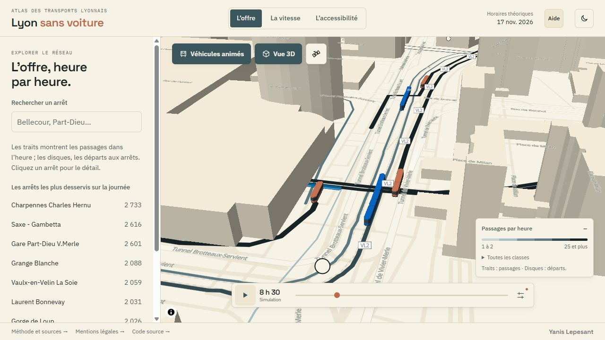
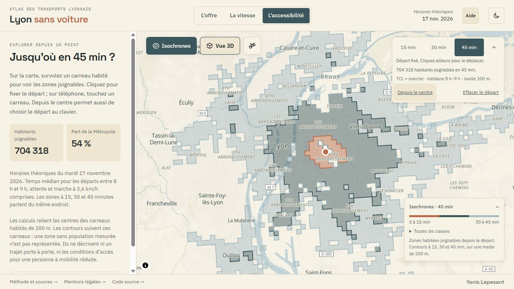

# Lyon sans voiture

**Jusqu’où va le réseau TCL ?** Une carte interactive pour explorer l’offre, les vitesses et l’accessibilité des
transports en commun lyonnais, calculées de bout en bout à partir de données ouvertes.

**[Explorer la carte](https://atlas-lyon.drekky.fr/)** · **[Voir les véhicules en 3D](https://atlas-lyon.drekky.fr/#offre-demo)**


Toutes les mesures portent sur les horaires théoriques d’un jour de référence, le **mardi 17 novembre 2026**,
un jour de semaine ordinaire hors vacances scolaires. Les véhicules sont simulés à partir de ces horaires :
ce ne sont ni des positions GPS ni des retards réels.

## En chiffres

| Jour de référence | |
|---|---|
| Courses programmées | 20 705 |
| Départs aux arrêts | 440 127 |
| Arrêts desservis | 2 588 |
| Kilomètres parcourus | 225 697 |
| Tronçons entre deux arrêts | 5 795 |
| Carreaux habités de 200 m | 7 879 (1,31 million d’habitants) |
| Temps de trajet calculés avec R5 | 62 millions (chaque carreau vers chacun des autres) |

## Ce que l’on peut explorer

- **L’offre** : passages par heure sur chaque tronçon, départs à chaque arrêt, et les véhicules en circulation,
  modélisés à leur taille réelle en 3D parmi les bâtiments.
- **La vitesse** : vitesse commerciale de chaque ligne et de chaque tronçon, arrêts compris, par période de la journée.
- **L’accessibilité** : part de la population joignable en 30 ou 45 minutes depuis chaque carreau habité, temps depuis
  six grands pôles, et isochrones à 15, 30 et 45 minutes depuis le point de son choix.

La carte passe en vue satellite et en relief ; l’interface est pensée pour le téléphone comme pour le bureau.

| Véhicules en 3D à la Part-Dieu | Isochrones depuis le 3e arrondissement |
|---|---|
|  |  |

## Points de méthode

- **Arrêts logiques.** Les quais de même nom distants de moins de 250 m, ou rattachés à une même station, forment un arrêt.
- **Tracés reconstitués.** Le flux ne fournit pas le tracé du métro, du tram et des funiculaires : la chaîne retient la
  relation OpenStreetMap qui passe au plus près des arrêts, dans leur ordre.
- **Vitesse commerciale.** Rapport des kilomètres cumulés aux heures cumulées, jamais moyenne de vitesses. Les horaires
  étant arrondis à la minute, la vitesse d’un tronçon se mesure sur une fenêtre de cinq inter-arrêts.
- **Accessibilité.** r5py (moteur R5) combine transports et marche à 3,6 km/h ; chaque départ est simulé minute par
  minute entre 8 h et 9 h et la durée médiane est retenue. Les services scolaires sont exclus, comme pour l’offre.
- **Isochrones.** La matrice des temps est publiée en un petit fichier binaire par origine (une minute par octet),
  chargé à la demande ; les contours sont tracés dans le navigateur.
- **Véhicules.** Chaque course suit son tracé entre deux horaires, avec arrêt, accélération et freinage. De près, les
  véhicules prennent leur gabarit : bus de 12 ou 18 m, trams en cinq modules, métros voiture par voiture.

Le détail est dans la [méthode de calcul](docs/traitement.md) et la [méthode des isochrones](docs/isochrones.md).

## Limites

- L’offre est théorique : ni retards, ni perturbations, ni travaux.
- La population est celle des ménages fiscaux (Insee Filosofi 2021), un peu en deçà de la population recensée.
- Le périmètre est celui du GTFS TCL, Rhônexpress et lignes régionales compris : les moyennes par mode en tiennent compte.
- Les isochrones relient les centres des carreaux habités : une zone sans population n’est pas représentée.

## Stack technique

- **Données** : Python, DuckDB et SQL.
- **Calcul d’accessibilité** : r5py / R5, réseau piéton OpenStreetMap et population Insee, dans un conteneur Docker.
- **Application** : Vue 3, TypeScript et MapLibre GL JS, sans serveur applicatif.
- **Déploiement** : fichiers statiques précompressés, Docker et nginx.


Les calculs sont réalisés avant publication : le navigateur charge les données exportées et dessine la carte.

## Démarrage local

Avec **Node.js 24**, depuis la racine du dépôt :

```bash
cd web
npm ci
npm run dev -- --host 127.0.0.1 --port 5180 --strictPort
```

Ouvrir [localhost:5180](http://localhost:5180/). Les données exportées sont incluses dans le dépôt : aucun recalcul
ni compte externe n’est nécessaire. Le fond de carte demande une connexion Internet.

Pour régénérer les données avec Python et Docker, suivre la [préparation et les étapes de calcul](docs/traitement.md).
Les paramètres, dont le jour de référence, sont dans [config.py](pipeline/atlas/config.py).

## Vérifications et déploiement

Depuis `web/` :

```bash
npm test
npm run build
```

La CI lance aussi les tests Python, contrôle l’intégrité des données, les dépendances, l’absence de secrets et l’image
de production. La page `web/verification-mobile.html`, servie par le serveur de développement, affiche l’application
à plusieurs tailles d’écran.

La construction produit `web/dist/`, à servir avec un serveur statique. Le dépôt fournit une image nginx et un
[exemple de déploiement Docker derrière Traefik](docs/deploiement.md), avec compression des données et protections HTTP.

## Organisation

```text
pipeline/   Préparation des données, calculs et tests Python
web/        Application Vue et données exportées dans public/data/
docs/       Méthodes, interface et déploiement
outils/     Contrôles des données et du dépôt
```

## Sources et licences

- **SYTRAL Mobilités** : horaires GTFS du réseau TCL, sous licence ODbL.
- **OpenStreetMap** : tracés, réseau piéton et bâtiments, sous licence ODbL ; fond de carte fourni par OpenFreeMap.
- **Insee, Filosofi 2021** : population carroyée à 200 m, sous Licence Ouverte.
- **IGN, BD ORTHO®** : photographies aériennes de la vue satellite, sous Licence Ouverte 2.0.

Le code est publié sous [licence MIT](LICENSE). Les couches dérivées de `web/public/data/` sont diffusées sous
licence ODbL, comme leurs sources. La méthode et les crédits sont aussi accessibles dans l’application.

Conçu et développé par [Yanis Lepesant](https://portfolio.drekky.fr/).
