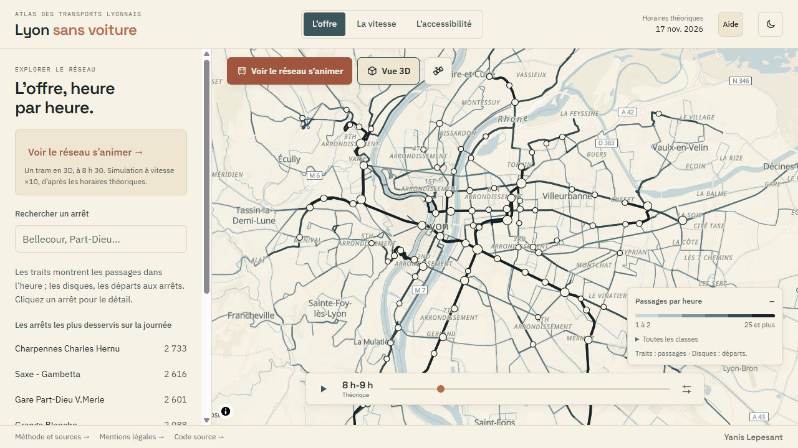
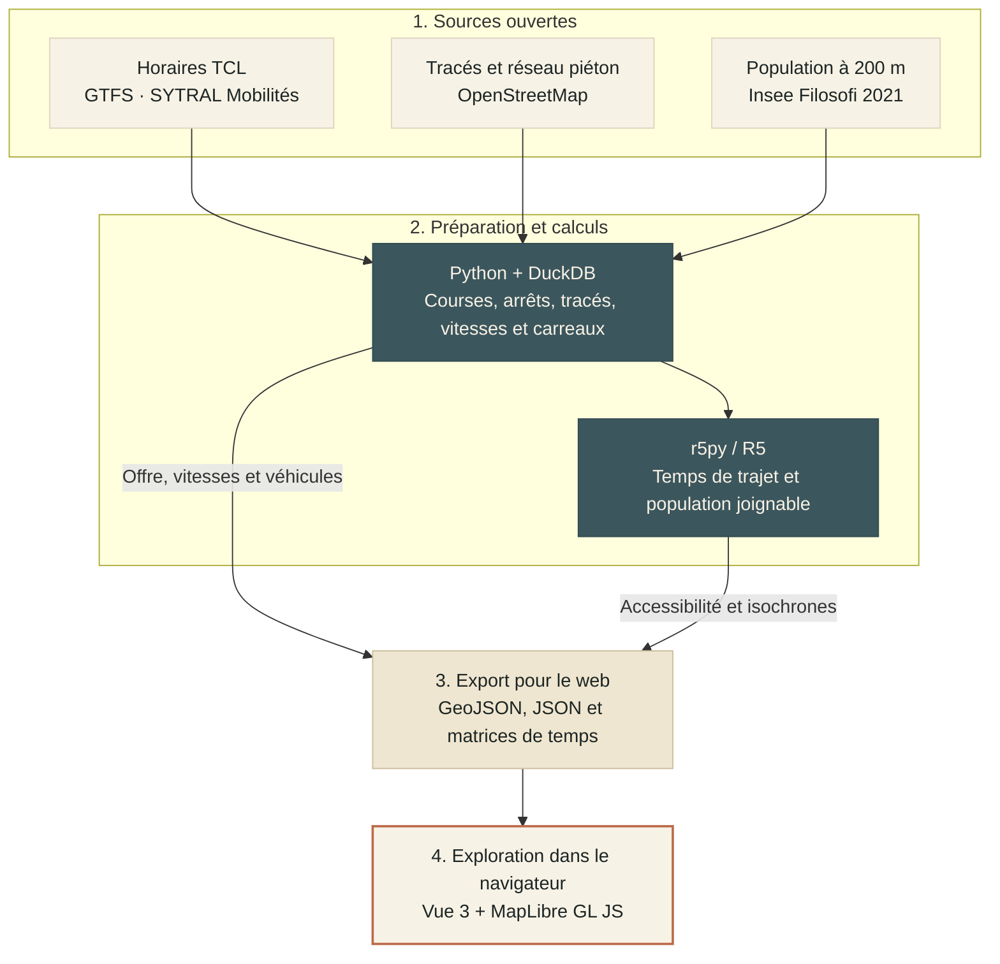

# Lyon sans voiture

Une carte interactive pour explorer l’offre, les vitesses et l’accessibilité du réseau TCL à partir de données ouvertes.

**[Explorer la carte](https://atlas-lyon.drekky.fr/)** · **[Voir les véhicules en 3D](https://atlas-lyon.drekky.fr/#offre-demo)**



Ce prototype utilise les horaires théoriques du **17 novembre 2026**. Les véhicules sont simulés à partir de ces horaires : ils ne représentent ni des positions GPS ni les retards réels.

## Fonctionnalités

- **L’offre** : fréquences par tronçon, départs aux arrêts et animation des véhicules au fil de la journée. La découverte démarre en 3D à 8 h 30, en ×10.
- **La vitesse** : vitesses commerciales des lignes et des tronçons, arrêts compris, avec comparaison par période.
- **L’accessibilité** : population joignable en transports et à pied, temps depuis de grands pôles et isochrones à 15, 30 et 45 minutes depuis un point choisi.

L’interface s’adapte au téléphone et au bureau. Le fond de carte, la vue satellite et les bâtiments en 3D se règlent directement sur la carte.

## Stack technique

- **Données** : Python, DuckDB et SQL.
- **Calcul d’accessibilité** : r5py / R5, réseau piéton OpenStreetMap et population Insee.
- **Application** : Vue 3, TypeScript et MapLibre GL JS.
- **Déploiement** : fichiers statiques, Docker et nginx.

## Chaîne de traitement



Les calculs sont réalisés avant publication. Le navigateur charge les données exportées et dessine la carte ; le serveur de l’application ne calcule pas d’itinéraire à la demande.

## Démarrage local

Avec **Node.js 24**, depuis la racine du dépôt :

```bash
cd web
npm ci
npm run dev -- --host 127.0.0.1 --port 5180 --strictPort
```

Ouvrir [localhost:5180](http://localhost:5180/). Les données exportées sont incluses dans le dépôt : aucun recalcul ni compte externe n’est nécessaire pour lancer l’application. Le fond de carte nécessite une connexion Internet.

Pour régénérer les données avec Python et Docker, suivre la [préparation et les étapes de calcul](docs/traitement.md). Les paramètres, dont le jour de référence, sont dans [config.py](pipeline/atlas/config.py).

## Vérifications et déploiement

Depuis `web/` :

```bash
npm test
npm run build
```

La CI vérifie aussi les tests Python, l’intégrité des données, les dépendances, l’absence de secrets et l’image de production. Le [contrôle responsive local](http://localhost:5180/verification-mobile.html) permet de vérifier les petits écrans.

La construction produit `web/dist/`, à servir avec un serveur statique. Le dépôt fournit une image nginx et un [exemple de déploiement Docker derrière Traefik](docs/deploiement.md), avec compression des données et protections HTTP.

## Organisation

```text
pipeline/   Préparation des données, calculs et tests Python
web/        Application Vue et données exportées dans public/data/
docs/       Méthodes, interface et déploiement
outils/     Contrôles des données et du dépôt
```

## Documentation

- [Préparation des données et méthode de calcul](docs/traitement.md)
- [Isochrones : méthode, formats et recalcul](docs/isochrones.md)
- [Interface et navigation mobile](docs/refonte-atlas.md)
- [Déploiement et compression](docs/deploiement.md)

## Sources et licences

- **SYTRAL Mobilités** : horaires GTFS du réseau TCL, sous licence ODbL.
- **OpenStreetMap** : tracés, réseau piéton et bâtiments, sous licence ODbL ; fond de carte fourni par OpenFreeMap.
- **Insee, Filosofi 2021** : population carroyée à 200 m, sous Licence Ouverte.
- **IGN, BD ORTHO®** : photographies aériennes de la vue satellite, sous Licence Ouverte 2.0.

Les couches dérivées publiées dans `web/public/data/` sont diffusées sous licence ODbL. La méthode et les crédits sont également accessibles dans l’application.

Conçu et développé par [Yanis Lepesant](https://portfolio.drekky.fr/).
