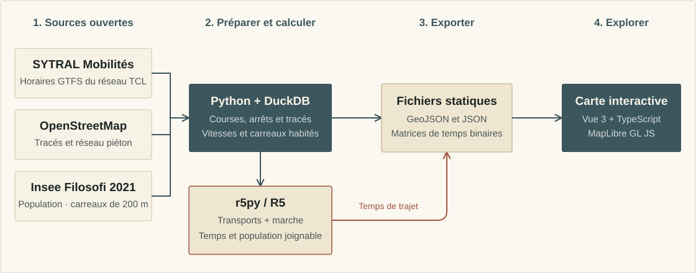

# Préparation des données et méthode de calcul

L’application utilise des données préparées en amont, puis exportées dans `web/public/data/`.
Ces exports sont versionnés : il suffit de lancer l’application pour les consulter.



## Sources et paramètres

[config.py](../pipeline/atlas/config.py) définit les sources, les chemins et les paramètres :

- horaires GTFS TCL de SYTRAL Mobilités ;
- extrait OpenStreetMap de Lyon, pour les tracés et la marche ;
- population Insee Filosofi 2021, par carreau de 200 m ;
- limites des communes de la Métropole de Lyon ;
- jour de référence : 17 novembre 2026 ; services scolaires « Junior Direct » exclus.

Le jour de service court de 4 h à 4 h le lendemain. Les calendriers GTFS et leurs exceptions déterminent les courses retenues.

## Méthode

### Offre et tracés

Python et DuckDB regroupent les quais de même nom à moins de 250 m, ou rattachés à une même station.
Un départ correspond à un véhicule quittant l’arrêt avec prise en charge de voyageurs ; les arrivées au terminus ne comptent pas.

Lorsque le GTFS ne fournit pas de tracé, les relations OpenStreetMap permettent de reconstituer le parcours
en respectant l’ordre des arrêts. À défaut, les arrêts sont reliés en ligne droite.

### Vitesses commerciales

La vitesse est le rapport des kilomètres cumulés aux heures cumulées, arrêts compris ; ce n’est pas une moyenne de vitesses.
Les horaires étant arrondis à la minute, la mesure par tronçon utilise une fenêtre de cinq inter-arrêts.

### Animation des véhicules

Chaque véhicule suit le tracé de sa course et ses horaires théoriques. Quand plusieurs arrêts successifs partagent
la même minute, le temps est réparti selon la distance. L’animation comprend un court arrêt, une accélération et un freinage.
Les fichiers sont répartis par heure ; les positions et les modèles 3D sont dessinés dans le navigateur.
Il ne s’agit pas d’un suivi GPS et les retards ne sont pas pris en compte.

### Accessibilité et isochrones

r5py, interface Python du moteur R5, combine transports en commun et marche à 3,6 km/h.
Les départs sont évalués minute par minute entre 8 h et 9 h ; la durée médiane est retenue.
Le calcul porte sur les centres des 7 879 carreaux habités de 200 m de la Métropole.

Les mêmes agences scolaires sont exclues du GTFS envoyé à R5 et du calcul d’offre.
Les temps entre origines et destinations sont exportés en matrices binaires pour l’exploration dans le navigateur.
Voir la [méthode des isochrones](isochrones.md) pour les seuils, le format, les limites et la reprise des calculs.

## Régénérer les données

**Prérequis : Docker.** Le conteneur du pipeline inclut Python, r5py et Java 21.
Les commandes suivantes se lancent depuis la racine du dépôt.

```bash
docker compose --profile pipeline build pipeline
docker compose --profile pipeline run --rm pipeline telecharger
```

Avant de calculer, préparer le CSV Insee attendu par `Parametres.filosofi_csv` :
`data/raw/insee_filosofi/extracted/carreaux_200m_met.csv`, ou adapter ce chemin dans `config.py`.
Cet extrait n’est pas versionné ; le téléchargement et l’extraction de l’archive nationale ne préparent pas automatiquement ce fichier.
Le lecteur attend les colonnes `idcar_200m`, `ind`, `men`, `men_pauv`, `ind_snv` et `lcog_geo`.

```bash
docker compose --profile pipeline run --rm pipeline calculer
docker compose --profile pipeline run --rm pipeline accessibilite
docker compose --profile pipeline run --rm pipeline exporter
docker compose --profile pipeline run --rm pipeline isochrones
```

Les données de travail restent dans `data/`, ignoré par Git. Les résultats destinés à la carte sont dans `web/public/data/`.
La commande `tout` enchaîne téléchargement, calcul, accessibilité et export ; **elle n’inclut pas les isochrones**.
Après modification des paramètres ou des sources, recalculer aussi celles-ci pour garder un jeu cohérent.

## Tests et contrôles

Dans un environnement virtuel Python 3.11 ou supérieur :

```bash
python -m pip install -e "./pipeline[dev]"
python -m pytest pipeline/tests
python outils/verifier_longueurs.py
python outils/verifier_isochrones.py
```

Les tests Python utilisent un mini-réseau GTFS : calendriers, services scolaires, heures après minuit,
terminus, vitesses pondérées et reconstitution des tracés. Le contrôle des isochrones vérifie les matrices publiées.
La règle des fichiers de 200 lignes au plus est appliquée par la CI.
